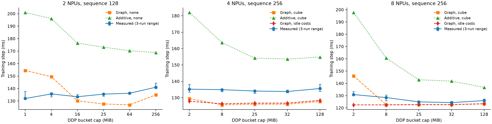

# Predicting HCCL overlap from measured gradient dependencies

A dependency graph predicts held-out DDP bucket configurations more accurately than adding computation and communication times on 2, 4 and 8 Ascend 910B2C NPUs. The evaluation covers 16 rank-count/bucket configurations and 48 independent distributed training runs. Automatic bucket selection remains close to the measured best configuration but does not establish a throughput improvement over the default 25 MiB cap.

| NPUs | Graph MAPE | Additive MAPE | Selected / best (MiB) | Slower than best | Slower than default |
|---:|---:|---:|---:|---:|---:|
| 2 | 7.77% | 33.59% | 64 / 1 | 3.20% | 0.54% |
| 4 | 5.74% | 19.97% | 8 / 32 | 0.84% | 0.62% |
| 8 | 4.23% | 22.65% | 8 / 32 | 3.29% | 2.82% |

## Workload and measurement protocol

Training executes the complete public Qwen3-0.6B architecture: 28 transformer layers and 596,049,920 trainable parameters, with BF16 parameters, eager attention and AdamW. Parameters are initialized from a recorded random seed. Each rank processes a batch of two sequences. Every process performs two warmup steps and six measured steps. Reported step time includes forward, backward, gradient communication and the optimizer update; compilation, initialization and warmup are excluded.

| Protocol | Sequence length | Inputs | HCCL calibration | Candidate caps (MiB) |
|---|---:|---|---|---|
| 2 NPUs | 128 | Seeded synthetic token IDs | Isolated, wall-clock completion | 1, 4, 16, 25, 64, 256 |
| 4 NPUs | 256 | Public SQuAD text | Device events, idle and concurrent Cube work | 2, 8, 25, 32, 128 |
| 8 NPUs | 256 | Public SQuAD text | Device events, idle and concurrent Cube work | 2, 8, 25, 32, 128 |

Expanded calibration uses 16 documents containing 88,903 tokens; evaluation uses a separate partition of 19 documents containing 115,434 tokens. Each process samples fixed-length spans with its recorded seed. Calibration uses seed 321 and a 2048 MiB bucket cap. Evaluation uses seeds 1000, 1001 and 1002. The prediction and selected cap are saved before any candidate evaluation. For each measured step, the slowest rank determines completion; each distributed run contributes its median of six steps, and the result reports the median and full range across three independent runs.

Measurements run in an exclusive device window on one host. Cards 12–15 provide four ranks and cards 8–15 provide eight ranks within one HCCS group. The runtime is Python 3.11.14, PyTorch 2.9.0, torch-npu 2.9.0.post1 and CANN 8.5.1; exact package versions are retained in `configs/environment.json`.

## Dependency model

Post-accumulation hooks record each parameter's gradient-ready time using NPU events. A communication hook records actual bucket membership and delegates reduction and averaging to PyTorch's standard DDP hook. The calibration reduces all gradients in one large bucket. For each parameter and rank, the predictor takes the median ready time across measured calibration steps.

The graph contains a compute chain for each rank and a node for every predicted collective. Compute intervals span successive gradient-ready events; the first interval includes the forward pass. Each collective waits for all member gradients on every rank and for the preceding collective. Parameters remain whole when constructing DDP buckets, so a single large parameter may exceed the target cap. The final optimizer node waits for both computation and communication. Its cost is the measured residual between backward completion and step completion. The critical path gives the predicted step time. The additive baseline uses the slowest rank's complete compute chain plus all collective and optimizer costs.

Independent HCCL microbenchmarks cover eleven message sizes from 4 KiB to 512 MiB. Each size has three warmup and three measured repetitions per process, with three independent calibration processes. The cost model first takes the maximum rank duration for each repetition, then the median over the repetitions; intermediate message sizes use linear interpolation. Collective outputs are checked against their expected sum. Expanded protocols measure both idle collectives and collectives launched while 32 BF16 4096×4096 matrix multiplications are queued on another NPU stream. The Cube-cost graph is the predefined main model, and the idle-cost graph is its ablation.

## Held-out results

### Two NPUs, sequence length 128

| Cap (MiB) | Measured (ms) | Three-run range (ms) | Graph (ms) | Additive (ms) |
|---:|---:|---:|---:|---:|
| 1 | 132.02 | 131.60–137.69 | 154.49 | 201.03 |
| 4 | 135.68 | 133.30–136.76 | 149.52 | 196.06 |
| 16 | 133.43 | 133.07–135.25 | 130.22 | 176.41 |
| 25 | 135.52 | 133.77–136.09 | 127.64 | 173.18 |
| 64 | 136.24 | 135.93–136.91 | 126.90 | 170.35 |
| 256 | 141.03 | 139.89–144.44 | 134.92 | 168.87 |

### Four NPUs, sequence length 256

| Cap (MiB) | Measured (ms) | Three-run range (ms) | Graph (ms) | Additive (ms) |
|---:|---:|---:|---:|---:|
| 2 | 135.22 | 133.35–138.17 | 129.51 | 182.06 |
| 8 | 134.92 | 133.71–134.99 | 125.64 | 163.61 |
| 25 | 134.09 | 132.70–134.20 | 126.06 | 154.20 |
| 32 | 133.80 | 133.07–134.74 | 126.06 | 153.58 |
| 128 | 135.62 | 133.89–138.24 | 127.74 | 154.83 |

### Eight NPUs, sequence length 256

| Cap (MiB) | Measured (ms) | Three-run range (ms) | Graph (ms) | Additive (ms) |
|---:|---:|---:|---:|---:|
| 2 | 130.86 | 130.24–133.38 | 146.02 | 197.80 |
| 8 | 128.44 | 125.80–130.54 | 122.57 | 160.61 |
| 25 | 124.92 | 123.33–125.19 | 122.75 | 142.95 |
| 32 | 124.35 | 124.06–125.43 | 122.75 | 141.84 |
| 128 | 125.95 | 125.75–127.29 | 123.47 | 136.76 |

The graph improves absolute step-time prediction across all three protocols. Selection requires resolving much smaller differences between candidates, so lower overall prediction error does not ensure the best ranking. Independent-run ranges overlap for the selected and default caps at two and four ranks. At eight ranks, the selected cap is 2.82% slower than the default and their observed ranges are disjoint. The measured selection gaps and default comparisons above remain part of the result.

## Concurrent-cost ablation and communication critical paths

| NPUs | Idle-cost graph MAPE | Cube-cost graph MAPE | Idle / cube choice (MiB) | Computation pending at launch |
|---:|---:|---:|---:|---:|
| 4 | 5.58% | 5.74% | 8 / 8 | 396 / 396 |
| 8 | 3.25% | 4.23% | 2 / 8 | 792 / 792 |

The pending-computation count verifies that queued matrix work had not finished when each communication measurement began. It does not measure how long the two streams overlapped. Idle and Cube cost tables, including every message size, are retained in `results/summary.json`. Cube costs increase MAPE in both expanded protocols. At eight ranks they improve the selection gap from 5.23% to 3.29%, even while increasing prediction error from 3.25% to 4.23%. The selected cap remains slower than the default, and the divergence between these two metrics illustrates why accurate absolute timing is insufficient for close candidate rankings.

| NPUs | Cap (MiB) | Collectives | Communication on critical path (ms) | Exposed communication tail (ms) |
|---:|---:|---:|---:|---:|
| 2 | 25 | 29 | 69.34 | 23.81 |
| 2 | 64 | 13 | 66.51 | 23.07 |
| 4 | 8 | 85 | 10.00 | 10.00 |
| 4 | 25 | 29 | 10.42 | 10.42 |
| 8 | 8 | 85 | 4.86 | 4.86 |
| 8 | 25 | 29 | 5.04 | 5.04 |

Communication on the critical path sums collective durations along that path. The exposed tail is the interval from the last gradient-ready compute event to the last collective completion. These measure different parts of the schedule and need not be equal. The full per-candidate graphs and path statistics are retained with the numerical results.

The predicted and actual steady-state bucket layouts match in all 1,296 evaluated rank-steps, including bucket order, parameter membership and byte size. Partition errors therefore do not explain the residual timing errors on this workload. Four CPU tests cover final joins, overlap, slowest-rank dependencies, rank aggregation and separate cost conditions.

## Hardware trace evidence

`analyze_trace.py` extracts actual Ascend operator names, device streams, collective intervals, per-stream order and explicit profiler flows. Gradient-to-collective dependencies come from the instrumented training semantics. Separate two-rank traces at a 1 MiB cap contain 33,768 and 33,764 operator records. Interval unions measure 114.19 and 140.45 ms of compute/all-reduce overlap, alongside 140.05 and 167.55 ms of all-reduce intervals without compute. These aggregates demonstrate actual overlap and exposed communication in the captured trace window; they are not per-step timing estimates. The compact trace summary is `results/trace_summary.json`.

## Limitations

The evaluation covers one model architecture on one host and one HCCS group. Rank counts are calibrated separately; the experiments test held-out bucket configurations, not extrapolation to unmeasured rank counts. The two-rank protocol differs in sequence length, inputs and timing method from the expanded protocols. Per-rank batch size is fixed, so the expanded experiments change global batch size. Model weights are randomly initialized; the work measures execution performance, not trained model quality.

The predictor uses gradient-readiness intervals rather than a complete resource-constrained operator replay. It holds the compute timeline fixed when changing bucket size and represents contention through a separately measured cost table. Per-bucket preparation, DDP averaging and host-launch costs are not modeled as distinct nodes. Instrumentation can affect launch timing, and a fixed matrix background does not reproduce every communication/compute interaction in the model. These approximations can affect close candidate rankings. Profiling uses separate runs, and the three independent runs characterize the measured variation rather than a general statistical confidence bound. No cross-node or other-accelerator result is inferred.

## Reproduction and artifacts

`run_two_rank.sh` and `run_scaled.sh` perform independent calibration, freeze predictions and evaluate every candidate. `evaluate.py` computes run-level summaries; `summarize.py` validates bucket layouts and exports the combined figure and critical paths. Exact commands are in the README. The project retains architecture provenance, tokenized calibration/evaluation partitions, raw numerical records, fixed predictions and all three independent measurements. Local Ascend profiler exports are under `results/qwen06_profile_1mb/profiler/`.

## Research context

[CrystalLLM](https://minlanyu.seas.harvard.edu/writeup/sosp26.pdf) captures computation, communication and dependencies through context-switched execution and combines real ranks with virtual replay. This project studies dependency-based HCCL prediction and DDP bucket selection using actual ranks on one Ascend host. The architecture configuration comes from [Qwen3-0.6B](https://modelscope.cn/models/Qwen/Qwen3-0.6B); public text comes from [SQuAD 2.0](https://rajpurkar.github.io/SQuAD-explorer/dataset/dev-v2.0.json).
